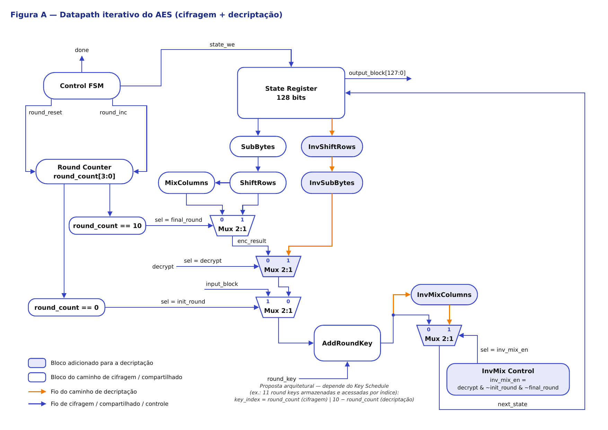
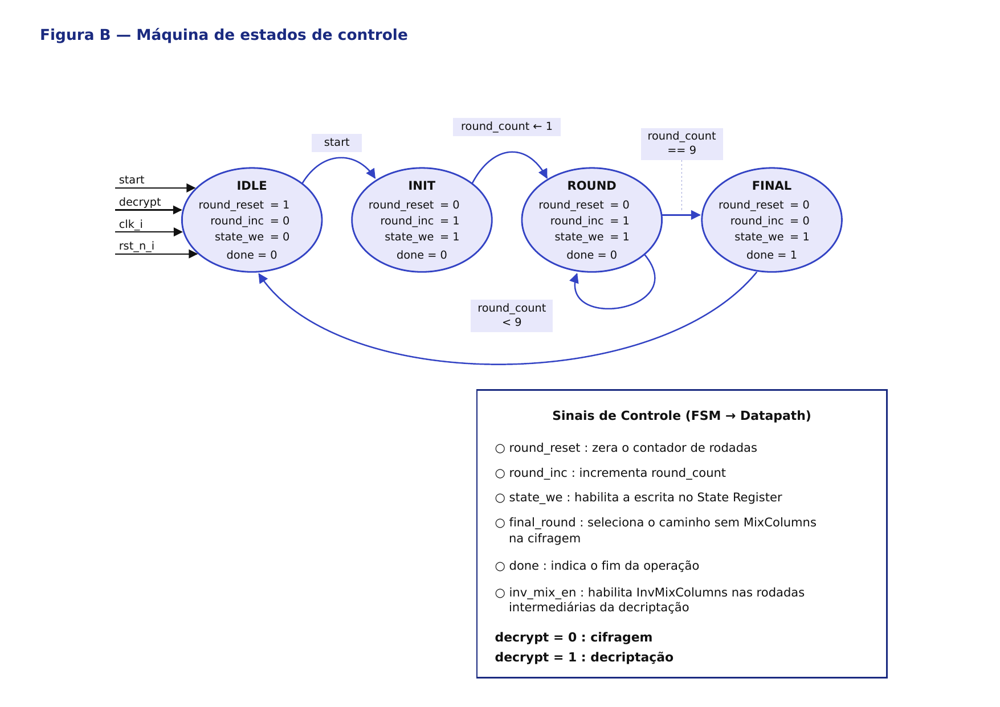

# Microarquitetura do Acelerador AES

## 1. Visão geral

A microarquitetura proposta utiliza um datapath iterativo para AES-128.

A mesma estrutura de hardware é reutilizada ao longo das rodadas, evitando a replicação completa das dez rodadas do algoritmo.

O estado atual do AES é armazenado em um registrador de 128 bits denominado `State Register`.

A arquitetura suporta dois modos de operação:

- `decrypt = 0`: cifragem;
- `decrypt = 1`: decriptação.

## 2. Datapath

O datapath definido para o acelerador é apresentado na figura abaixo.



> Versão vetorial: [aes_datapath.pdf](aes_datapath.pdf)

O caminho de cifragem utiliza:

```text
SubBytes
→ ShiftRows
→ MixColumns
→ AddRoundKey
```

Na rodada final, `MixColumns` é ignorado.

O caminho de decriptação utiliza:

```text
InvShiftRows
→ InvSubBytes
→ AddRoundKey
→ InvMixColumns
```

Na rodada final da decriptação, `InvMixColumns` também é ignorado.

O bloco `AddRoundKey`, o `State Register`, o contador de rodadas e a lógica de controle são compartilhados entre cifragem e decriptação.

## 3. Controle das rodadas

O contador `round_count[3:0]` representa a rodada atual.

Os sinais derivados do contador são:

```text
round_count == 0  → init_round
round_count == 10 → final_round
```

Eles são utilizados para controlar os multiplexadores do datapath:

- `init_round` seleciona a entrada inicial do AES antes da primeira rodada;
- `final_round` permite ignorar `MixColumns` ou `InvMixColumns` na última rodada.

## 4. Máquina de estados

A lógica de controle utiliza uma FSM com quatro estados: `IDLE`, `INIT`, `ROUND` e `FINAL`.

### Diagrama da máquina de estados

A máquina de estados utilizada para controlar a execução do AES é apresentada na figura abaixo.



### IDLE

Aguarda o comando `start`.

```text
round_reset = 1
round_inc   = 0
state_we    = 0
done        = 0
```

### INIT

Executa o `AddRoundKey` inicial.

```text
round_reset = 0
round_inc   = 1
state_we    = 1
done        = 0
```

### ROUND

Executa as rodadas intermediárias.

```text
round_reset = 0
round_inc   = 1
state_we    = 1
done        = 0
```

### FINAL

Executa a última rodada.

```text
round_reset = 0
round_inc   = 0
state_we    = 1
done        = 1
```

O `output_block[127:0]` contém o resultado válido da operação quando `done = 1`.

## 5. Seleção das chaves

A seleção das chaves de rodada foi definida inicialmente como:

```text
Cifragem:     key_index = round_count
Decriptação:  key_index = 10 - round_count
```

> **Observação:** essa definição é uma proposta arquitetural e depende da implementação do `Key Schedule`. Uma possível implementação é armazenar as 11 chaves de rodada e acessá-las pelo índice correspondente.

## 6. Controle do InvMixColumns

O bloco `InvMixColumns` deve ser utilizado somente nas rodadas intermediárias da decriptação.

Foi definida a lógica:

```text
inv_mix_en = decrypt & ~init_round & ~final_round
```

Assim:

| Situação | `InvMixColumns` |
|---|---|
| Cifragem | não utiliza |
| Decriptação — etapa inicial | não utiliza |
| Decriptação — rodadas intermediárias | utiliza |
| Decriptação — rodada final | não utiliza |
